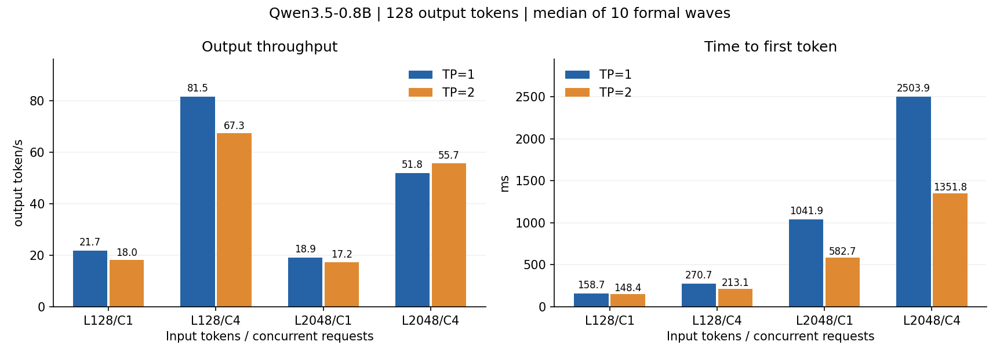
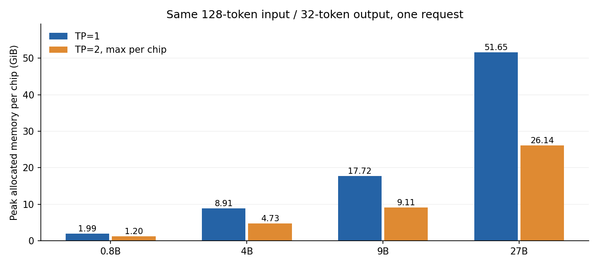
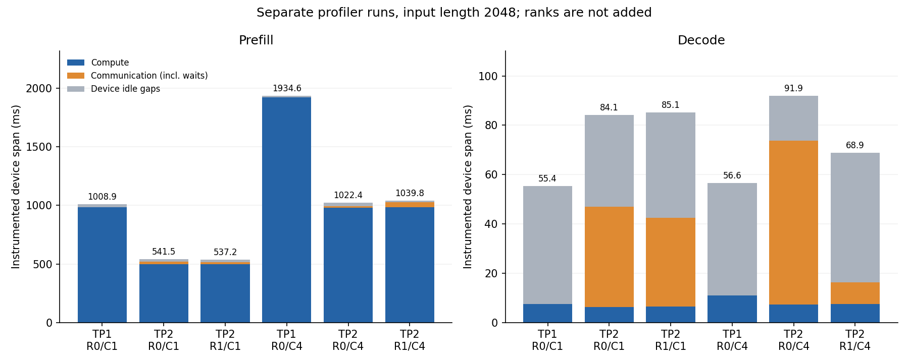

# 第二次作业实验报告：双 chip TP 推理与通信分析

实验日期：2026 年 11 月 7 日。代码基于小组 `codex/ascend-qwen35-08b` 分支的 `226c19b1784e`，工作分支为 `codex/ascend-qwen35-tp2`。

四个指定模型均完成同卡双 chip 的 TP=2 连续推理、正常结束检查及 TP=1/2 对照。本报告依次说明实现方法、切分与通信、正确性验证，以及性能和通信实验结果。

## 小组成员及主要贡献

分工按适配集成、正确性验证、性能与通信分析三个方向安排，各成员承担约三分之一工作量，共同完成结果复核与报告讨论。

| 小组成员 | 主要贡献 | 工作量占比 |
|---|---|---|
| 庄嘉毅 | 双 chip 环境与进程启动、HCCL 接口适配、四模型权重加载与 TP=2 部署、设备映射审计、端到端集成和启动复现脚本 | 约 1/3 |
| 陈秋阳 | Attention/GDN/MLP 的权重与状态切分验证、TP=1/2 逐步输出对照、结果一致性检查、卷积精度问题修复、算子与状态回归测试 | 约 1/3 |
| 马知微 | 输入长度与并发性能矩阵、大模型 HBM 容量测量、Profiler 计算/通信/等待分析、batch 通信实验、数据图表与报告整理 | 约 1/3 |

## 1. 实验目标与固定配置

本阶段将同一个模型的 Attention/GDN 和 MLP 计算切分到两个 chip，分析容量收益、计算分摊、集合通信及同步代价。模型分别部署测试，未以两个独立副本替代 TP。

硬件为 Ascend 910C，正式实验使用同一张卡的物理 chip 0/1，每 chip 64 GiB 标称 HBM；PCIe 地址为 `0000:9D:00.0`、`0000:9F:00.0`。设备映射通过可见设备、逻辑设备、PID、参数形状和两 rank 的运行日志共同验证。服务器为共享环境，未终止其他用户进程；driver 占用快照保存在原始实验目录。

软件为 Python 3.11.16、PyTorch 2.9.0、torch-npu 2.9.0、CANN 9.0.0、驱动 25.5.2、Triton-Ascend 3.2.1、Transformers 5.12.0。个人虚拟环境复用公共框架，未修改公共环境。权重来自 Qwen 官方 ModelScope 仓库，按不可变文件 revision、大小和 SHA256 校验；0.8B 复用了作业 1 已校验缓存。

所有正式 TP 对照保持相同权重、FP16 权重/激活/KV/卷积历史、FP32 GDN 递推状态与卷积乘加、greedy、eager、DP=1、PP=1。关闭前缀复用、offload、投机解码、图捕获和 all-reduce/norm 融合。缓存 token 容量固定为 16384，保证并发 4 的长输入可容纳。四模型实际结构如下。

| 模型 | 层数 | hidden / MLP 中间维 | Q / KV 头 | GDN K / V 头 | TP=2 每 rank 的 GDN 状态 |
|---|---:|---|---|---|---|
| 0.8B | 24 | 1024 / 3584 | 8 / 2 | 16 / 16 | `[P,8,128,128]` |
| 4B | 32 | 2560 / 9216 | 16 / 4 | 16 / 32 | `[P,16,128,128]` |
| 9B | 32 | 4096 / 12288 | 16 / 4 | 16 / 32 | `[P,16,128,128]` |
| 27B | 64 | 5120 / 17408 | 24 / 4 | 16 / 48 | `[P,24,128,128]` |

完整环境与模型配置分别见 [环境记录](../results/hw2-environment.json)、[模型配置](../results/hw2-model-configs.json)。

## 2. 适配与可复现实现

复用 TokenSpeed 的 Mapping、并行 Linear、CommManager、HCCL、LCM 状态管理及作业 1 的 Ascend 算子。本阶段新增分 rank 的权重/设备/状态审计、并发实验、逐步输出比较和时间线区间分析。

实际发现并修复两个问题：

1. HCCL 后端使用的 `torch.distributed.all_gather_single`、`reduce_scatter_single` 不存在于课程 PyTorch 2.9。改为支持的 `all_gather_into_tensor`、`reduce_scatter_tensor`，保留 TokenSpeed 自身接口。真实双 rank 检查覆盖 sum、gather、等长/不等长 reduce-scatter 及零行 rank。
2. 将因果卷积的乘加中间量统一为 FP32，输出与卷积历史仍使用 FP16，保持推理状态的存储精度和更新方式不变；40 项卷积测试全部通过。

实验观察器避免多个 rank 写同一文件，记录 PID、物理可见设备、逻辑设备、参数和状态形状。正式 benchmark 不逐 forward 强制同步、不复制 logits 到 CPU；诊断与 profiler 独立运行。大体积 logits、完整请求和 trace 位于服务器 `~/hw2-runs`，Git 内只保存小型结果。

最终运行统一标记 `v2`，关键 HCCL、卷积和 GDN 文件的 SHA256 在正确性与性能实验间一致。原始修复前结果保留作诊断，不与最终数据混合。相关说明见 [复现文档](../docs/ascend-qwen35-tp2.md)、[源码指纹](../results/hw2-final-source-manifest.json)。

## 3. 典型层的切分、通信和状态

以下按 PyTorch 存储权重 `[out,in]` 记号，T 为一次 forward 实际处理的 token 数。两个 rank 持有同一组 token、位置和层边界隐藏状态 `[T,1024]`，持有互补的权重和 head。

| 0.8B 典型计算 | TP=1 | TP=2 每 rank | 汇总方式 |
|---|---|---|---|
| MLP gate / up 各自权重 | `[3584,1024]` | `[1792,1024]` | 输出特征切分 |
| 融合 gate/up 输出 | `[T,7168]` | `[T,3584]` | 各 segment 分别切分 |
| SwiGLU 输出 | `[T,3584]` | `[T,1792]` | 本地计算 |
| MLP down 权重 | `[1024,3584]` | `[1024,1792]` | 产生 `[T,1024]` 部分和后 AllReduce |
| 全注意力 Q / KV heads | `8 / 2` | `4 / 1` | 按 head 切分 |
| 含 Q gate 的融合 QKV 权重 | `[5120,1024]` | `[2560,1024]` | Q、gate、K、V 各自正确切分 |
| 全注意力输出投影 | `[1024,2048]` | `[1024,1024]` | 部分和 AllReduce |
| GDN Q/K/V/Z/B/A 融合投影 | `[8224,1024]` | `[4112,1024]` | 各 packed segment 分别切分 |
| GDN 卷积权重 | `[6144,1,4]` | `[3072,1,4]` | depthwise 通道本地计算 |
| GDN 递推状态 | `[P,16,128,128]` | `[P,8,128,128]` | 随本地 value head 切分，FP32 |
| 卷积历史 | `[P,6144,3]` | `[P,3072,3]` | FP16，本地状态页 |
| GDN 输出投影 | `[1024,2048]` | `[1024,1024]` | 部分和 AllReduce |

P 随缓存配置变化，实际形状保存在每 rank 的 cache audit。4B/9B 的 GDN K/V 头比为 1:2，27B 为 1:3；head 及其关联卷积通道、门控、`A_log`、`dt_bias` 一致切分。全注意力 KV 按 KV head 切分；位置、请求标识和调度元数据复制。hidden RMSNorm、head 内 QK Norm 及 GDN head 内归一化的权重按其语义复制。

`RowParallelLinear(reduce_results=False)` 的规约由 CommManager 执行，不能再额外规约一次。词表切分 Embedding 对 masked lookup 结果 AllReduce；本次启用完整 logits 的 LM Head 路径执行词表 AllGather 后 greedy。原理对应老师的 [TP/SP 材料](https://llm-infra-atlas.github.io/parallel/02_tp_sp/)，集合通信语义见 [Collectives 材料](https://llm-infra-atlas.github.io/hpc/04_collectives/)。

## 4. 并行运行与正确性

四模型均完成至少 32 步固定长度连续生成，并另外验证算术对话返回 `42` 后正常 EOS。TP=2 每 rank 参数约为 TP=1 的一半，少量 norm 等参数复制，状态 head 也按 TP 减半；两个 rank 都执行完整层序列并参与 HCCL。该证据排除了仅启动两进程或两个完整副本的情况。

| 模型 | rank 0 PID / 逻辑设备 | rank 1 PID / 逻辑设备 | 物理可见设备 |
|---|---|---|---|
| 0.8B | 1453557 / npu:0 | 1453558 / npu:1 | 0,1 |
| 4B | 1431368 / npu:0 | 1431369 / npu:1 | 0,1 |
| 9B | 1454905 / npu:0 | 1454906 / npu:1 | 0,1 |
| 27B | 1456120 / npu:0 | 1456121 / npu:1 | 0,1 |

表中 PID 来自最终正确性运行的两份 weight audit；例如 [27B rank 0](../results/hw2-final-27b-rank-0-weight-audit.json)、[27B rank 1](../results/hw2-final-27b-rank-1-weight-audit.json)。运行与内存记录见 [证据目录](../results/hw2-evidence)。

TP=1 与 TP=2 使用相同权重、精度、输入和生成参数，逐步比较生成 token 与模型输出分数。0.8B 覆盖 1、128、2048 token 输入各 32 步，其他模型覆盖 128 token 输入的 32 步。比较限定于实际生成的步骤，结果如下。

| 模型 | 输入 token 数 | 对比步数 | 生成 token 一致率 | 输出分数最大差异 |
|---|---|---:|---:|---:|
| 0.8B | 1、128、2048 | 96 | 100% | 0.085938 |
| 4B | 128 | 32 | 100% | 3.189941 |
| 9B | 128 | 32 | 100% | 0.968750 |
| 27B | 128 | 32 | 100% | 1.674805 |

模型输出分数是每一步对全部 248320 个候选 token 的评分，表中最后一列为 TP=1 与 TP=2 的逐项最大绝对差异。本次测试共比较 192 步，四模型的生成 token 序列全部一致；TP=2 两个 rank 聚合后的完整输出分数逐位一致。TP=1 与 TP=2 的完整分数存在表中所示差异，生成结果一致的结论限定于本次测试范围。

逐步对比结果保存在各模型的 `hw2-*-v2-tp-correctness.json` 中。配套测试包括 HCCL/统计测试 56 项、卷积测试 40 项，以及三种实际 GDN head 比例的切分测试 3 项，均通过。GDN 切分测试中，两个分片的输出与递推状态合并后与完整 head 计算逐位一致。

## 5. 性能、容量和通信实验

### 5.1 测量口径

0.8B 采用 TP=1/2 × 输入 128/2048 × 并发 1/4，固定输出 128 token。每组独立预热 3 次、正式测量 10 个并发 wave，表中为正式 wave 中位数。并发请求以同一 barrier 同时提交，实际 batch 来自设备 forward 记录。

TTFT 从本地 Engine 提交请求到首个流式 token；TPOT 为首 token 到末 token 时间除以后续 token 数；输出吞吐为整个 wave 的输出 token 总数除以 wave 墙钟时间。它们包含引擎排队/调度和同批请求干扰，不等于单个 device kernel 时延。各 rank 的 HBM 为 PyTorch allocator 的 peak allocated；reserved 与 driver 占用另行保存，allocated 不代表上下文与 HCCL 的全部设备占用。

### 5.2 0.8B 的八组对照

| TP | 输入 token | 并发 | TTFT (ms) | TPOT (ms) | 输出 token/s | rank 0 峰值 GiB | rank 1 峰值 GiB |
|---:|---:|---:|---:|---:|---:|---:|---:|
| 1 | 128 | 1 | 158.66 | 45.16 | 21.71 | 1.993 | — |
| 1 | 128 | 4 | 270.69 | 46.94 | 81.55 | 1.999 | — |
| 1 | 2048 | 1 | 1041.94 | 45.11 | 18.90 | 2.113 | — |
| 1 | 2048 | 4 | 2503.95 | 57.53 | 51.82 | 2.217 | — |
| 2 | 128 | 1 | 148.36 | 54.82 | 18.01 | 1.199 | 1.199 |
| 2 | 128 | 4 | 213.14 | 57.74 | 67.32 | 1.203 | 1.203 |
| 2 | 2048 | 1 | 582.71 | 53.94 | 17.22 | 1.276 | 1.276 |
| 2 | 2048 | 4 | 1351.80 | 61.10 | 55.68 | 1.310 | 1.310 |

- 输入 128、并发 1：TP=2 的 TTFT 为 TP=1 的 0.935 倍，输出吞吐为 0.829 倍。
- 输入 128、并发 4：TP=2 的 TTFT 为 TP=1 的 0.787 倍，输出吞吐为 0.826 倍。
- 输入 2048、并发 1：TP=2 的 TTFT 为 TP=1 的 0.559 倍，输出吞吐为 0.911 倍。
- 输入 2048、并发 4：TP=2 的 TTFT 为 TP=1 的 0.540 倍，输出吞吐为 1.074 倍。

小模型 Decode 的计算量较小，新增的集合通信、同步和双 rank 发射开销可能抵消分摊收益。较长 Prefill 有更多卷积/GDN 通道计算可分摊，收益与 Decode 不同。上述结论只针对本次 eager 配置和共享服务器上的实测，不推断硬件理论上限。

### 5.3 四模型容量与 27B 性能

下表容量来自相同 128 入/32 出、单请求的正确性运行，包含该运行中的分配峰值。

| 模型 | TP=1 参数数 | TP=2 每 rank 参数数 | TP=1 峰值 GiB | TP=2 rank 0 / 1 峰值 GiB |
|---|---:|---:|---:|---|
| 0.8B | 752,393,024 | 376,224,288 | 1.993 | 1.199 / 1.199 |
| 4B | 4,205,751,296 | 2,102,962,432 | 8.909 | 4.728 / 4.728 |
| 9B | 8,953,803,264 | 4,477,038,336 | 17.723 | 9.113 / 9.113 |
| 27B | 26,895,998,464 | 13,448,336,640 | 51.649 | 26.139 / 26.139 |

27B 每 chip 峰值从 TP=1 的 51.649 GiB 降至 TP=2 的最大 26.139 GiB，降低 49.4%。本次短输入配置确实能运行 TP=1，因此没有把它标为 OOM。四模型分别测试，不要求同时驻留。

27B TP=2 补充两档输入和并发的容量/性能结果，固定输出 32 token，每组 3 次预热、3 次正式 wave；样本较少，只报告中位数与原始波动，不声称精确的尾延迟。

| TP | 输入 token | 并发 | TTFT (ms) | TPOT (ms) | 输出 token/s | rank 0 峰值 GiB | rank 1 峰值 GiB |
|---:|---:|---:|---:|---:|---:|---:|---:|
| 2 | 128 | 1 | 443.13 | 134.49 | 6.94 | 26.023 | 26.023 |
| 2 | 128 | 4 | 807.38 | 141.59 | 13.13 | 26.031 | 26.031 |
| 2 | 2048 | 1 | 2864.22 | 131.84 | 4.61 | 26.336 | 26.336 |
| 2 | 2048 | 4 | 9225.94 | 178.72 | 6.47 | 26.336 | 26.336 |

27B 此表没有相同工作负载的正式 TP=1 性能对照，不能据此声称 27B 获得了某一加速倍数。

### 5.4 计算、通信与等待

以下统计实际后端调用，逻辑输入字节不等于物理链路传输字节。对普通非 SP 的推理层，Attention/GDN 和 MLP 各一次部分和规约，外加 Embedding 规约与 logits 聚合。

| 模型 | 每 rank 每 Decode 步 AllReduce 数 | AllReduce 逻辑输入字节合计 | logits AllGather 数 / 每 rank 输入字节 |
|---|---:|---:|---|
| 0.8B | 49 | 100,352 | 1 / 248,320 |
| 4B | 65 | 332,800 | 1 / 248,320 |
| 9B | 65 | 532,480 | 1 / 248,320 |
| 27B | 129 | 1,320,960 | 1 / 248,320 |

采用独立 Profiler Level1 采样，每档先预热，再记录首个 Prefill 和首个纯 Decode。计算区间、通信区间分别取并集；两者交集为重叠；本次采样在该统计精度下几乎未观察到计算与通信重叠。首末设备任务之间的空白为 idle gap。HCCL 内等待和 SDMA copy task 从 `communication.json` 单独提取。等待累计和 copy task 累计不是可直接与其它项相加的端到端分解，也不能把两个 rank 的时间相加。

| TP / rank | 请求并发 / 实际 batch | 计算 ms | 通信区间 ms | 重叠 ms | 空闲间隙 ms | HCCL 等待累计 ms | SDMA copy task 累计 ms |
|---|---|---:|---:|---:|---:|---:|---:|
| 1 / 0 | 1 / 1 | 7.469 | 0.000 | 0.000 | 47.903 | 0.000 | 0.000000 |
| 1 / 0 | 4 / 2 | 11.053 | 0.000 | 0.000 | 45.503 | 0.000 | 0.000000 |
| 2 / 0 | 1 / 1 | 6.306 | 40.634 | 0.000 | 37.185 | 39.022 | 0.068060 |
| 2 / 0 | 4 / 2 | 7.379 | 66.347 | 0.000 | 18.159 | 64.942 | 0.072740 |
| 2 / 1 | 1 / 1 | 6.514 | 35.944 | 0.000 | 42.663 | 33.911 | 0.071096 |
| 2 / 1 | 4 / 2 | 7.484 | 8.738 | 0.000 | 52.656 | 6.188 | 0.078359 |

HCCL 区间包含对端等待和同步，不能全部视为有效搬运。SDMA copy task 时间也不是整卡链路带宽计数，部分传输分类可能重复描述同一搬运，本报告没有把 SDMA 与 SIO 相加计算“总流量”。空闲间隙可能来自主机发射、依赖和等待，不能仅凭空白确定唯一原因。Profiler 会扰动时序，表中数值只用于定位，正常吞吐/延迟始终使用上一节独立 benchmark。

### 5.5 通信相关实验：并发/实际 batch

假设：每 Decode 步 AllReduce 次数主要由层数决定，增加 batch 可以用同一批 collective 处理更多输出 token，摊薄每 token 的通信启动和同步代价；代价是更大的消息、状态和排队延迟。

改变因素为请求并发 1 与 4，保持模型、TP、输入/输出长度、精度和执行策略相同。实际 Decode batch 在记录中验证。若 batch=4，每步处理 4 个输出 token，而 0.8B 仍为 49 次 AllReduce 和 1 次 logits AllGather；每输出 token 的 AllReduce 启动次数由 49 降至 12.25，逻辑字节/token 大体不变。正常 benchmark 中 0.8B 的并发 4 大多形成 batch=4；输入 2048 的 TP=2 正式 Decode 中，batch=4 有 1260 次，batch=1/2/3 分别有 10/20/10 次。独立 profiler 采样的是首个纯 Decode，该时刻实际 batch=2，因此下面按 2 归一化，不能直接套用 12.25 的稳态示例。27B 的并发 4 未形成稳定 batch=4，不能把请求并发当作设备批量。完整直方图如下。

| 模型 / TP | 输入 / 并发 | rank 0 正式 Decode batch 直方图（batch:forward 数） |
|---|---|---|
| 0.8B / 1 | 128 / 1 | `{"1": 1271}` |
| 0.8B / 1 | 128 / 4 | `{"1": 10, "3": 10, "4": 1270}` |
| 0.8B / 1 | 2048 / 1 | `{"1": 1280}` |
| 0.8B / 1 | 2048 / 4 | `{"1": 10, "2": 20, "3": 10, "4": 1260}` |
| 0.8B / 2 | 128 / 1 | `{"1": 1275}` |
| 0.8B / 2 | 128 / 4 | `{"1": 9, "3": 10, "4": 1270}` |
| 0.8B / 2 | 2048 / 1 | `{"1": 1280}` |
| 0.8B / 2 | 2048 / 4 | `{"1": 10, "2": 20, "3": 10, "4": 1260}` |
| 27B / 2 | 128 / 1 | `{"1": 93}` |
| 27B / 2 | 128 / 4 | `{"1": 97, "2": 3, "3": 93}` |
| 27B / 2 | 2048 / 1 | `{"1": 96}` |
| 27B / 2 | 2048 / 4 | `{"1": 12, "2": 186}` |

时间线提供通信内等待和每步/每 token 暴露通信量的直接对照。

| 输入 2048 的 TP=2 | batch | AllReduce 次数/token | 暴露通信 ms/token | HCCL 等待累计 ms/token |
|---|---:|---:|---:|---:|
| rank-0 / 并发 1 | 1 | 49.00 | 40.634 | 39.022 |
| rank-0 / 并发 4 | 2 | 24.50 | 33.174 | 32.471 |
| rank-1 / 并发 1 | 1 | 49.00 | 35.944 | 33.911 |
| rank-1 / 并发 4 | 2 | 24.50 | 4.369 | 3.094 |

这里按该次采样 forward 的实际 batch 归一化，等待累计只作诊断量。每档仅一条 Prefill 和一条 Decode 时间线，不能据此推导平均链路时延或稳定的尾延迟。

性能表同时显示收益与代价。batch 变化也会改变 GEMM/卷积利用率和主机调度，因此不能把全部吞吐变化归因于通信。本实验以调用次数、消息大小、真实 batch、设备区间和端到端指标共同解释结果，未把仅修改启动参数当作结论。

## 6. 复现方法

服务器代码位于 `~/tokenspeed`，工作分支为 `codex/ascend-qwen35-tp2`。模型路径为 `/tmp/hw1-qwen35-model` 和 `~/models/Qwen3.5-{4B,9B,27B}`。实验使用同卡物理 chip 0/1，每次分别部署一个模型。

复现入口为 `scripts/qwen35_tp_experiment.py`，显式指定模型、TP、输入长度、并发、输出长度、预热与重复次数，以及新的结果目录。`capture` 模式用于连续推理与输出对照，`benchmark` 模式用于性能测量，`profile` 模式用于独立的计算与通信时间线采样。详细启动命令见 [复现文档](../docs/ascend-qwen35-tp2.md)。

实验数据与图表保存在 `results/`，完整请求、逐步输出和 profiler trace 保存在 `~/hw2-runs`。0.8B 另完成 TP=2 的 HTTP 端到端检查，算术回答为 `42` 并正常结束，中文回答连续生成至少 32 token；记录见 [接口测试](../results/hw2-http-tp2-smoke.json)。
