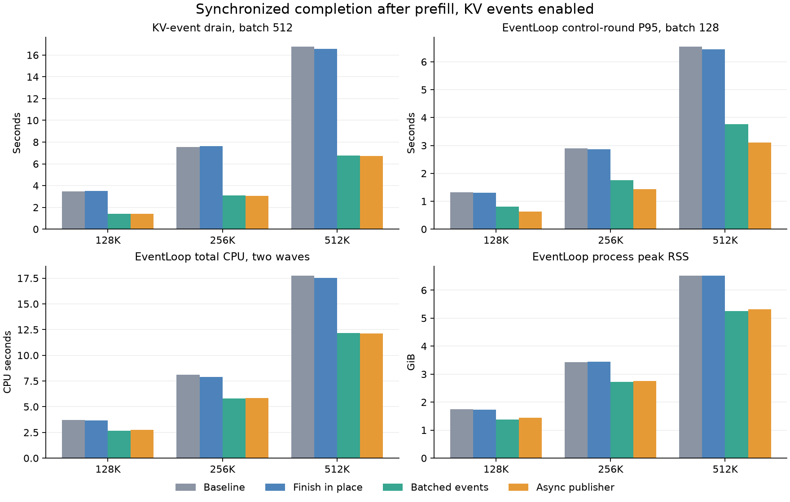

# Completion burst optimization

At batch 512 × 512K, event drain fell from 16.79 s to 6.74 s. With events disabled and the prefix already published, finish fell from 343 ms to 133 ms. The real EventLoop's 512K control-round P95 fell from 6.55 s to 3.10 s, with lower total CPU and peak RSS.

Long synchronized completions need to publish the final cache frontier, release request resources, and, when enabled, publish KV events. This experiment isolates three changes: advance final `CacheProgress` in place; share immutable event descriptors and drain a contiguous batch with one ordering point; move encoding and snapshot destruction to the publisher. The bridge event array remains local to each advance call; the routing view reuses its traversal/change arrays.

## Method

- Base: `6d7d29b918d1b050602cd945151dc99c076bd67f`. All four stages use this same base and the same benchmark instrumentation.
- Intel Xeon Platinum 8480+, GCC 10.3.1, Rust 1.96.1, optimized C++ and Rust builds; normal mimalloc defaults. Stage measurements use CPU 20. The real EventLoop uses CPUs 20–23, with control pinned to CPU 20.
- Stage matrix: batch 128/512 × prompt 128K/256K/512K × 1/2 generated tokens × events off/on. One full-history cache group, page size 64, distinct prefixes, prefix cache enabled, L2/L3 disabled, zero pre-existing hits, one warmup and three recorded trials. A K is 1024 tokens.
- One generated token finishes directly after prefill. Two tokens first publish the prompt through an ordinary decode admission, so final publication mostly has a tail left.
- EventLoop matrix: batch 128, the same three lengths, one/two tokens and events off/on; two successive waves, L2/L3 disabled, overlap depth 1, publisher queue capacity 1, one warmup and seven trials. GPU results are immediate CPU fixtures; ingress, scheduling, output processing, publisher and codecs are real.
- Each loop trial waits for plan/output workers and all accepted KV batches before recording total CPU and active wall time. The local publisher has no subscriber; separate real socket tests cover delivery and replay. Cache/interpreter teardown is excluded from active time but process peak RSS includes setup, warmups and allocator retention.
- Reported stage values are medians. Round P50/P95 pools rounds from seven trials; rounds in a wave are correlated, and idle/drain rounds are included. These are workload distributions, not production latency SLO estimates.

## Finish without the history copy

Two generated tokens, events disabled. Publication still releases historical page references; the complete finish is not constant time. Times are milliseconds.

| Batch | Prompt | Baseline finish | Finish only | Final finish | Baseline cleanup | Final cleanup |
| ---: | ---: | ---: | ---: | ---: | ---: | ---: |
| 128 | 128K | 20.84 | 8.39 | 8.57 | 5.22 | 5.24 |
| 128 | 256K | 45.99 | 16.38 | 16.34 | 11.62 | 10.33 |
| 128 | 512K | 86.23 | 39.22 | 37.21 | 23.06 | 24.27 |
| 512 | 128K | 89.99 | 36.21 | 40.32 | 21.69 | 22.90 |
| 512 | 256K | 175.67 | 69.27 | 69.80 | 42.98 | 41.52 |
| 512 | 512K | 342.99 | 134.18 | 132.83 | 85.07 | 86.51 |

## Event drain and encoding

Batch 512, direct completion after prefill, events enabled. The codec timer deliberately calls the production codec synchronously to expose its CPU cost; in final serving it runs on the publisher thread. Times are milliseconds.

| Prompt | Baseline drain | Batched drain | Final drain | Baseline codec | Final codec |
| ---: | ---: | ---: | ---: | ---: | ---: |
| 128K | 3,465.06 | 1,404.37 | 1,419.31 | 647.99 | 641.73 |
| 256K | 7,528.80 | 3,114.52 | 3,071.02 | 1,303.14 | 1,310.51 |
| 512K | 16,786.79 | 6,782.47 | 6,736.32 | 2,693.94 | 2,676.57 |

## Real EventLoop

Values compare baseline → final. CPU includes all worker threads through drain completion. RSS is the process high-water mark, in MiB. Each case processes two waves of 128 requests.

| Prompt | Tokens | Events | Round P50 ms | Round P95 ms | Total CPU ms | Active wall ms | Peak RSS MiB |
| ---: | ---: | :---: | ---: | ---: | ---: | ---: | ---: |
| 128K | 1 | off | 108.37 → 107.55 | 236.36 → 234.39 | 819.14 → 813.54 | 806.33 → 801.91 | 899 → 871 |
| 256K | 1 | off | 242.27 → 224.12 | 484.87 → 483.64 | 1,727.25 → 1,620.12 | 1,703.63 → 1,596.31 | 1,742 → 1,742 |
| 512K | 1 | off | 479.79 → 469.95 | 902.07 → 899.88 | 3,466.09 → 3,393.52 | 3,423.82 → 3,352.26 | 3,364 → 3,355 |
| 128K | 2 | off | 39.12 → 27.31 | 236.30 → 234.16 | 819.84 → 785.41 | 808.13 → 774.11 | 892 → 899 |
| 256K | 2 | off | 99.71 → 58.90 | 480.65 → 484.51 | 1,765.21 → 1,715.16 | 1,739.66 → 1,692.20 | 1,755 → 1,742 |
| 512K | 2 | off | 207.86 → 157.72 | 914.79 → 891.91 | 3,575.34 → 3,394.60 | 3,532.05 → 3,354.56 | 3,366 → 3,370 |
| 128K | 1 | on | 321.89 → 311.51 | 1,319.51 → 630.50 | 3,719.47 → 2,730.22 | 3,720.45 → 2,547.46 | 1,782 → 1,474 |
| 256K | 1 | on | 698.75 → 654.34 | 2,902.95 → 1,435.11 | 8,113.60 → 5,831.47 | 8,119.04 → 5,494.53 | 3,517 → 2,820 |
| 512K | 1 | on | 1,486.92 → 1,345.48 | 6,548.52 → 3,099.67 | 17,763.45 → 12,144.36 | 17,783.10 → 11,445.90 | 6,681 → 5,450 |
| 128K | 2 | on | 47.98 → 35.48 | 1,328.46 → 624.23 | 3,745.44 → 2,663.40 | 3,746.72 → 2,475.23 | 1,846 → 1,474 |
| 256K | 2 | on | 109.93 → 69.10 | 2,844.62 → 1,394.60 | 8,009.07 → 5,816.82 | 8,013.47 → 5,452.18 | 3,654 → 2,832 |
| 512K | 2 | on | 303.81 → 142.52 | 6,401.75 → 3,089.24 | 17,704.13 → 12,157.65 | 17,729.77 → 11,416.38 | 6,903 → 5,545 |

## Publisher backlog

Every recorded trial ended with zero pending batches/bytes after waiting for the publisher. Byte counts charge native snapshot sizes through send completion and exclude replay buffers and allocator slack. Baseline bytes charge encoded payloads, so the two formats' byte counters are not directly comparable. Queue capacity bounds batch count; a blocked producer and the active worker are counted as well.

| Prompt | Tokens | Peak outstanding batches | Peak charged MiB | Median enqueue ms | Median final drain wait ms |
| ---: | ---: | ---: | ---: | ---: | ---: |
| 128K | 1 | 2 | 73.5 | 0.04 | 162.19 |
| 256K | 1 | 2 | 147.0 | 0.04 | 315.82 |
| 512K | 1 | 2 | 294.0 | 0.04 | 564.28 |
| 128K | 2 | 2 | 73.5 | 0.04 | 159.01 |
| 256K | 2 | 2 | 147.0 | 0.03 | 316.42 |
| 512K | 2 | 2 | 294.0 | 0.04 | 644.39 |

## Repeated control for bridge allocation

A persistent forward-event array was also evaluated. It regressed a control with a fresh scheduler, so the final bridge keeps the event array local to each advance call. The routing view still reuses traversal/change buffers. Each comparison below alternates three processes per version, each with one warmup and seven samples: batch 128, 256K prompt, one generated token, events disabled. Times are finish milliseconds.

| Comparison | Synchronous batched control | Publisher variant | Difference |
| --- | ---: | ---: | ---: |
| Experimental persistent array | 315.93 | 375.11 | +18.7% |
| Final local array | 311.64 | 313.46 | +0.6% |

The first comparison's slowdown was not stable under profiling. It does not establish a specific allocator cause; unprofiled repetitions determined which implementation to keep.

## Profile attribution

Profiled batch 128 × 512K with two generated tokens and events enabled. Values are inclusive median milliseconds; nested spans must not be added. Conversion includes array growth and payload allocations.

| Stage | Bridge call | C++ advance | Conversion | Event destruction |
| --- | ---: | ---: | ---: | ---: |
| baseline | 244.19 | 86.97 | 145.54 | 0.04 |
| finish | 208.13 | 40.89 | 167.20 | 0.03 |
| events | 43.94 | 43.79 | 0.04 | 0.01 |
| async | 43.71 | 43.53 | 0.03 | 0.01 |

Conversion includes its string/token allocations. These measurements locate the expensive interval without establishing which allocator operation caused it.

## Allocator diagnostic

Final version, batch 128 × 512K with two generated tokens: one warmup and five profiled samples per setting. These are separate processes, not a long-running RSS experiment. Main comparisons above use defaults. Times are milliseconds.

| Events | Purge delay | Finish median | Finish range | Conversion median | Peak RSS MiB |
| :---: | --- | ---: | ---: | ---: | ---: |
| off | default | 33.10 | 31.70–67.96 | 0.07 | 2,586 |
| off | -1 | 32.64 | 31.85–39.36 | 0.07 | 2,614 |
| on | default | 37.37 | 32.08–64.32 | 0.11 | 3,471 |
| on | -1 | 36.36 | 32.18–45.44 | 0.10 | 3,498 |

## Limits and validation

The bounded queue still blocks when full. Encoding and event token/hash batch destruction moved to the publisher; request page references, slots, IDs and session registrations keep their original control-thread lifetimes. Request history destruction also remains there. Host writeback preserves its existing full-history hash enqueue and ordering; its lifetime is tested, but its performance is outside this matrix. This change does not add a generic background request reclaimer or replace every history string with `ContentHash`.

The bridge profiles split value conversion and event destruction. Conversion includes its backing-array, string and token allocations; these timers do not isolate allocator cleanup from ordinary allocation. `MIMALLOC_PURGE_DELAY=-1` remains a diagnostic, not a runtime default. No production GPU workload, slow remote subscriber, sustained queue saturation or long-running RSS soak is claimed.

Validation: 1521 C++ tests passed (one skipped); 289 Rust tests passed (14 opt-in workloads ignored); Python event-list lifetime/order, MessagePack golden bytes, actual PUB/replay, bounded-channel backpressure, Host-store/checkpoint lifetime and request-ID reuse are covered. `cargo clippy --all-targets -- -D warnings`, `cargo fmt`, and `pre-commit run --all-files` passed.

Run the matrices using the commands and JSON schema in [README.md](README.md). The complete stage and loop medians are in [finish_stages.csv](finish_stages.csv) and [finish_loop.csv](finish_loop.csv).
